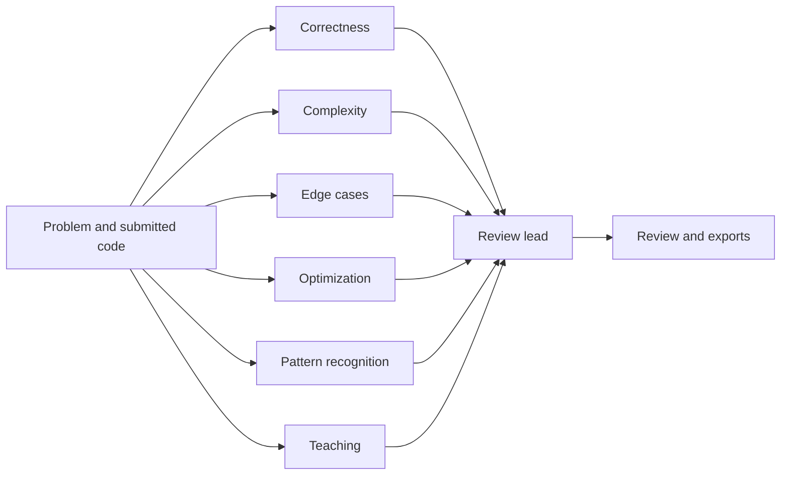

# LeetCode Mentor

A coding interview practice studio built with Next.js, TypeScript, and Groq, hosted on an isolated AWS ECS/Fargate service.

[Open the AWS app](https://le-80e062e4d2034c75b1f46046a682e5a3.ecs.us-east-2.on.aws)

## Practice, understand, explain

Paste a problem and solution, choose Quick or Deep review, and get feedback on correctness, complexity, optimizations, and algorithm patterns. Deep review streams the status of six independent specialists and a seventh review lead that reconciles their findings. Interview rehearsal is a separate, optional coaching request.

The studio includes a code editor, starter problems, pattern lessons, browser-tab saves, optional Supabase sign-in and owner-scoped history, Markdown downloads, and a full Print / Save as PDF report. AI analysis does not execute code or prove correctness. Results show unavailable specialists rather than silently claiming a complete review.

## Run the web app

Use Node.js 22. In `web/`, run `npm ci`, copy `.env.example` to `.env.local`, set the server-only `GROQ_API_KEY`, and run `npm run dev`. Open http://localhost:3000. Optional Supabase configuration and storage policies are described in [web/README.md](web/README.md).

Run `npm run typecheck`, `npm test`, and `npm run build` in `web/`. API and orchestration tests mock provider calls and spend no AI credits.

## Seven-specialist workflow

Concurrency and admission are bounded. Deep reviews include request cancellation, provider retries, per-call/overall timeouts, partial-result reporting, and actual stage timing/usage metadata. They run asynchronously within an HTTP request; they are not durable background jobs and do not survive server restarts.

## Evaluation and performance

The repository includes [50 original benchmark tasks](web/benchmarks/corpus.ts), a [resumable benchmark protocol](web/benchmarks/README.md), and [initial measurements](web/benchmarks/RESULTS.md). Sequential and parallel modes run the same seven stages. Simulated timings are labelled separately from real-provider measurements. A 60% real-world reduction has not been established, and code-review quality has not yet been manually benchmarked.

## AWS and CI/CD

Optional account features use a dedicated Mentor Supabase project. The repository integration adds personal public GitHub links, folder browsing, source-file imports, and review associations. Follow the [Supabase setup runbook](web/supabase/SETUP.md) before enabling accounts; this application does not create hosted projects or apply database migrations automatically.

[Web release instructions](deploy/WEB_RELEASE.md) describe the isolated Mentor CodeBuild, ECR, and ECS deployment and rollback. [CI/CD design](deploy/CICD.md) covers PR tests, container smoke checks, OIDC, immutable image tags, environment protection, and opt-in production releases. Continuous deployment remains opt-in pending its dedicated roles and GitHub environment configuration.

This deployment uses the dedicated `leetcode-mentor` stack and does not modify System Design Simulator. A branded hostname requires a domain controlled by the owner; the AWS-generated HTTPS URL remains available meanwhile.

## Legacy Python application

The original Streamlit application, Groq-powered diagram generation, GitPython publishing, ReportLab PDF utilities, and Rich terminal interface remain in the repository. They are separate from the current Next.js workspace. The web app does not automatically publish solutions to GitHub.

For legacy local development, install `requirements.txt` in a Python 3.12 virtual environment and run `python -m streamlit run app.py`. Run the Python suite with `python -m pytest -q`. The earlier Streamlit-hosted version may still be available at https://leetcode-mentor-by-abdulraziq.streamlit.app and may run older code.
