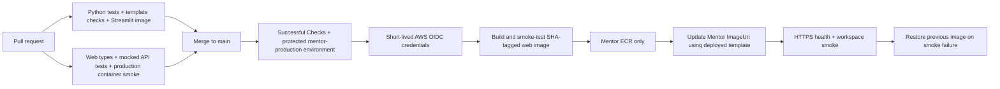

# Mentor release pipeline

The application PRs form a stack: #7 (bring the isolated infrastructure onto main), #5 (Next.js workspace), #6 (engaging practice UI), then this CI/CD PR. The original infrastructure PR #4 merged into the old workspace branch after that branch landed; #7 brings those changes onto main. Retarget each following PR to main after its base merges. No workflow publishes from a PR or changes System Design Simulator.

## Activation after review

The pipeline is delivered as code; it is disabled until repository variable `MENTOR_CD_ENABLED` is exactly `true`. This PR does not create AWS roles, alter GitHub environments, run database migrations, or deploy the replacement app.

1. Create GitHub environment `mentor-production`. Restrict deployment branches to main and configure required reviewers before activation. OIDC's environment subject alone does not restrict branches.
2. Configure GitHub's OIDC provider in account `675345028735` with audience `sts.amazonaws.com`. Create a dedicated Mentor deployment role whose trust matches only this repository and the `mentor-production` environment. Inspect the repository's actual subject format: GitHub may include immutable owner/repository IDs. Do not trust all repositories or reuse a System Design Simulator role. See [GitHub's AWS OIDC guide](https://docs.github.com/en/actions/how-tos/secure-your-work/security-harden-deployments/oidc-in-aws).
3. Create a dedicated CloudFormation service role named `leetcode-mentor-*`, trusted by CloudFormation. Scope its resource permissions to the existing Mentor stack's resources and the ECS Express operations needed to update its image. Grant it PassRole only on the existing Mentor execution/infrastructure roles. Review the current stack and actual AWS authorization requirements before provisioning; this document does not supply an account-wide administrator policy.
4. Scope the GitHub role to ECR push/read for the repository in the Mentor stack's `RepositoryUri` output; `ecr:GetAuthorizationToken` requires resource `*`. Grant CloudFormation DescribeStacks and UpdateStack only for `arn:aws:cloudformation:us-east-2:675345028735:stack/leetcode-mentor/*`, and PassRole only for the dedicated CloudFormation role, restricted to `cloudformation.amazonaws.com`. CloudFormation's role must have the underlying resource permissions; UpdateStack permission alone is insufficient. Never use either application's interactive full-access login role in CI.
5. Set environment variables `MENTOR_DEPLOY_ROLE_ARN` and `MENTOR_CF_ROLE_ARN` to those reviewed roles. Preserve the existing server-side Groq secret; the workflow neither reads nor replaces its value. Configure optional Supabase runtime secrets separately in a reviewed Mentor infrastructure PR if persistent accounts are wanted. Without that configuration, the web app uses browser-tab saves.
6. Set repository variable `MENTOR_CD_ENABLED=true`. Run the workflow manually from main for the first release. Subsequent successful push checks on main trigger it automatically. Disable the variable to stop subsequent deployments.

CI uses Node 22 and Python 3.12. PR checks have read-only GitHub permissions and no AWS credentials; AI requests are mocked. The web container is built without secrets and runs as the non-root `node` user on port 8501. The health rewrite preserves the current `/_stcore/health` probe, so no network/template changes are required for the web migration.

## Release and rollback behavior

The workflow checks out the tested commit SHA, rejects stale main releases, serializes production deployments without cancelling a running release, builds and smoke-tests the production image, and pushes an immutable `web-<full SHA>` tag. Existing tags are reused only after ECR confirms they exist. Build/test failures stop before stack changes.

Deployment validates account, region, stack status, repository prefix, HTTPS hostname, and the dedicated CloudFormation role name. It changes only `ImageUri`, preserves all other parameter values, and reuses the **deployed** template. See [AWS UpdateStack](https://docs.aws.amazon.com/cli/latest/reference/cloudformation/update-stack.html). It waits for stack completion before checking public health and recognizable workspace HTML. The current stack still has one task; deployments may interrupt active sessions. AI-provider calls and Supabase operations are not exercised by smoke tests.

CloudFormation handles a failed stack update through its rollback behavior; a waiter failure fails the job and requires inspection before retrying. If the update succeeds but public smoke checks fail, the script requests the previous image and waits for that update. A failed rollback remains a failed job and requires investigation. The successful job summary records both deployed and previous image references. For a manual rollback, use the recorded previous image as ImageUri on the same stack, retaining its other parameters and template. Do not rebuild an old tag or modify the simulator stack.

Local validation does not activate production CD or verify OIDC role permissions. GitHub environment and IAM setup are explicit remaining activation work.
