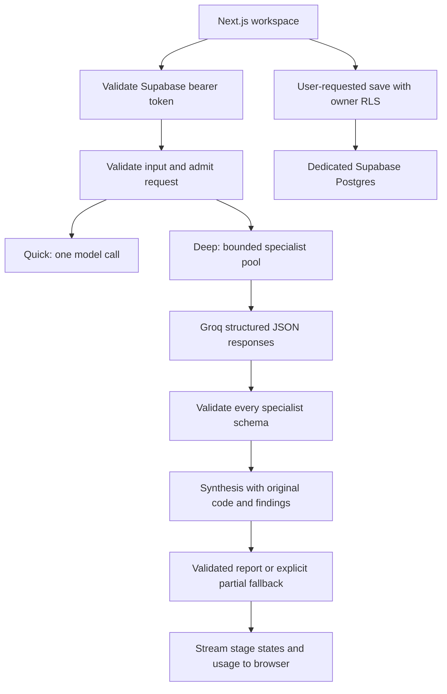

# LeetCode Mentor: AI engineering case study

## Problem and scope

An interview learner needs feedback that separates bugs, complexity, boundary cases, and improvements. A single response can blur those concerns. Mentor offers a one-call Quick review and a Deep review with six specialist calls followed by synthesis. The engineering question is whether that extra orchestration produces useful feedback within acceptable latency, token usage, and failure rates. Seven calls alone do not establish better quality.

This is an applied LLM systems project. It does not train or fine-tune models, execute submissions, implement retrieval-augmented generation, or run autonomous background workers. Its strengths are orchestration, typed integration, failure handling, application security, and deployment.

## Request path and trust boundaries

Submitted code, repository files, and specialist text are untrusted input. Instructions tell the model to treat them as data; that is a mitigation, not a prompt-injection guarantee. Provider credentials remain on the server. Browser configuration contains only the Supabase URL and public key. Supabase validates identity and database row policies enforce ownership independently of UI filtering.

Public GitHub imports are read-only. The server validates repository URLs, paths, visibility, file type and size. GitHub login does not grant private-repository or commit access. Importing a file populates the editor; a review request sends its contents to the model provider. Users should avoid submitting confidential code without authorization.

## Decisions and tradeoffs

| Decision | Implemented behavior | Consequence |
| --- | --- | --- |
| Parallel specialists, then synthesis | At most six specialist workers; synthesis starts after their results settle | Shorter critical path is possible, with additional tokens, quota pressure, and correlated model errors |
| Schema-first model boundary | Strict JSON Schema request and Zod parsing of responses | Malformed output is rejected; valid structure does not imply accurate reasoning |
| Bounded retries and deadlines | Retry selected structured-output failures and rate limits; 60-second provider deadline and 180-second Deep deadline | Bounds waiting; outages can still produce partial reports or errors |
| Partial results | A failed specialist is shown as unavailable; synthesis failure falls back to completed findings | Preserves useful work while exposing missing analysis |
| Admission control | Two Deep requests per server process | Limits local fan-out; multiple replicas need a shared quota limiter |
| Request-bound execution | Cancellation and live NDJSON updates in the active request | No durable resume after task/container restart |
| Single model backend | Default `openai/gpt-oss-120b` through Groq, configurable on the server | Simple deployment; no independent multi-model consensus or provider failover |

Implementation references: [pipeline](../web/src/lib/server/pipeline.ts), [model adapter](../web/src/lib/server/ai.ts), [authentication](../web/src/lib/server/auth.ts), [GitHub validation](../web/src/lib/server/github.ts), and [database policies](../web/supabase/mentor_repositories.sql).

## Evidence and limits

Stage traces contain states, durations, model identifiers, token counts and sanitized failures. They support diagnosing a single request; they are not yet a centralized production telemetry system. Aggregate token totals are not a dollar-cost estimate and do not capture all provider-side billing effects of retries.

The repository has 50 original tasks and paired sequential/parallel benchmark execution. [Recorded results](../web/benchmarks/RESULTS.md) distinguish simulated scheduling from live calls. The live pilot contains only one complete pair, with a 33.9% latency reduction; another pair was incomplete. A full-corpus 60% real-provider improvement and a quality improvement remain unproven. Keyword matching is advisory, not a correctness metric.

[PR #17](https://github.com/ARB726/leetcode-mentor/pull/17) adds a manual grading CLI and rubric with explicit coverage, evidence citations and unsupported-execution-claim counts. Shipping evaluation tooling is separate from completing the evaluation. Human rubric scores still require careful review and do not replace executable tests.

## Remaining milestones, in priority order

1. **Finish authenticated product verification.** Complete GitHub sign-in in the deployed app, link a public repository, import a file, save a review, reload history, and unlink while preserving the review. Database isolation has been checked separately; that does not prove the browser OAuth journey.
2. **Produce a quality and latency comparison.** Freeze cases and source fingerprints; grade retained outputs with the rubric, include valid and seeded-defect solutions, and disclose missing cases. Compare Quick, sequential specialists, and parallel specialists on the same cases. Repeat latency runs and publish sample counts, failures and token totals. Do not select only successful examples for the case study.
3. **Add adversarial regression cases.** Include code comments that request instruction overrides, contradictory specialist findings, truncated structured outputs, provider throttling, and cancellation. Success means safe failure or accurate warnings, rather than merely HTTP 200.
4. **Centralize operational evidence.** Add redacted request IDs, stage spans, aggregate latency/failure dashboards, and shared per-user/provider budgets. Keep user code, bearer tokens and raw prompts out of logs by default. Validate limits with concurrent requests across replicas.
5. **Complete release automation.** Configure the dedicated GitHub OIDC roles and protected deployment environment described in the CI/CD design, then demonstrate a release and rollback. PR checks already exist; unattended production deployment is a separate milestone.

Durable queues, retrieval, more agents, and model fine-tuning should follow a measured requirement. They are not prerequisites for explaining the system clearly in an AI engineering interview.

## Demo and resume presentation

A short demo should show a seeded defect, the independent specialist statuses, the reconciled report, stage usage, and a failed-stage example. Then show the evaluation artifact and the deployment/rollback path. Discuss one case where synthesis was wrong and how it would become a regression test.

Evidence-backed resume wording today:

> Built and deployed a seven-stage LLM code-review application on AWS ECS/Fargate, with six concurrent specialists, schema-validated synthesis, streamed timing/token traces, bounded retries, cancellation, and partial-result handling.
>
> Integrated Supabase authentication and owner-scoped Postgres policies for saved reviews and public GitHub repository imports; developed a 50-task paired benchmark harness that separates synthetic scheduling results from live-provider measurements.

Add numerical quality, latency, adoption, or reliability outcomes only after the corresponding study or operational evidence exists. This positions the work around defensible AI systems decisions rather than an unsupported percentage.
